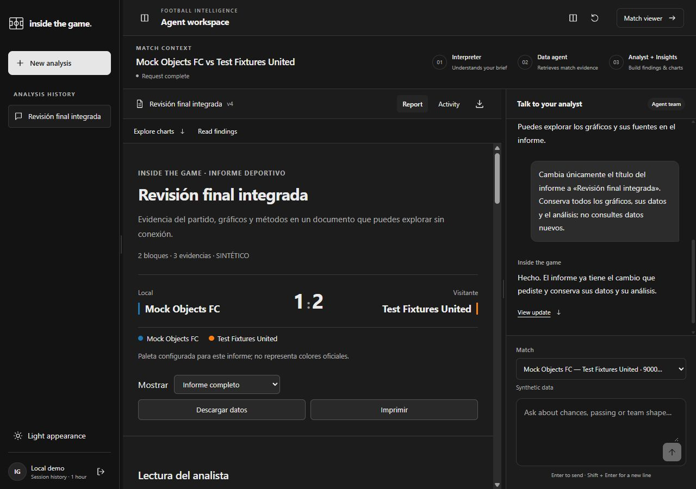
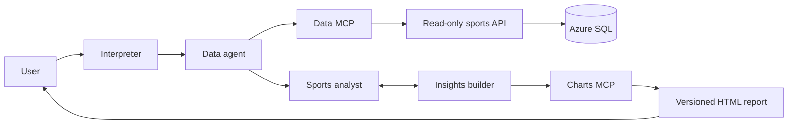

# Inside the Game

**Ask about a football moment. Reconstruct the play. Inspect the evidence.**

Inside the Game is a football analysis workspace for analysts and content teams.
Four cooperating agents turn a question into scoped match queries, a written
analysis and interactive charts. Users can replay recorded passages of play,
inspect the supporting evidence, revise the report in conversation and export
it as a self-contained HTML document.

Built for the **Microsoft x Premier League Inside the Game Hackathon**, with a
focus on purposeful multi-agent collaboration and explainable match intelligence.



*Recorded workspace screenshot: a synthetic match report, its revision and chat.
The screenshot includes Spanish output; analysis and conversation support six languages.*

[Evaluation access](#evaluation-access) · [Run locally](#run-locally) ·
[Try these prompts](#try-these-prompts) · [Architecture](#architecture) ·
[Verification](#verification) · [Documentation](#documentation)

## What you can do

- **Reconstruct a passage of play:** combine a pass map, recorded player positions
  and a replay of the same time window, including the opposition.
- **Ask for an explanation:** receive a written reading with references to the
  retrieved evidence, preserving the match, team, period and requested window.
- **Explore match patterns:** compose shot maps, illustrative synthetic xG,
  passing networks, team shape, Voronoi, connectivity and other spatial views.
  The library contains **30 parameterized insight recipes**; availability depends
  on the source and requested scope.
- **Refine the same report:** change titles, presentation or analytical focus
  through conversation, with explicit report revisions and evidence reuse.
- **Work in your language:** Spanish, English, Portuguese, French, Italian and
  German are supported for conversation and analysis. Source identifiers and
  evidence retain their original forms; interface translation coverage varies.
- **Take the result with you:** download interactive HTML and execution traces.

## Evaluation access

| Resource | Access and current status |
| --- | --- |
| Source code | This public repository. |
| Walkthrough video | In preparation. The public video URL still needs to be added here and to the submission. |
| Full agent workspace | Run locally using the setup below. It requires authorized data access and a configured model. A hosted workspace URL is not currently provided here. |
| Offline visual preview | Generate the synthetic chart gallery below, without a model, Azure account or data credentials. This previews the renderer. |
| Deployed data service | [API / Swagger](https://api-inside-game.redhill-f7b17d2a.canadacentral.azurecontainerapps.io/docs). Match queries require an individual credential. This endpoint serves API/MCP, not the complete agent workspace. |

The [official rules, section 4.8](https://github.com/microsoft/insidethegamehackathon/blob/main/OFFICIAL%20RULES.md#48-testing)
accept a website, functioning demo or test build. A public application URL is
not mandatory. Evaluators must receive a working route, configuration and any
required access for the judging period; private access instructions are allowed.
The public video must be **under two minutes** and show the application working.

Before submitting, publish the video URL and provide evaluator setup and access
in the submission's private testing instructions. Keep access valid throughout
judging. Never place API keys, model sessions or private credential files in this
README, the video, issues or Git. The offline gallery alone does not exercise the
four agents.

## Run locally

### 1. Install the project

The commands below use **Windows PowerShell** from the repository root.
Requirements:

- Python **3.12 or newer** with `venv` and `pip`.
- Git.
- For the React workspace: Node.js **24.22.1+ within 24.x**, or **26.12.1+ within
  26.x**, with npm, as specified in [frontend/package.json](frontend/package.json).

```powershell
git clone https://github.com/luis-pl/Inside-the-game-Developer-Hackathon.git
cd Inside-the-game-Developer-Hackathon
python -m venv .venv
.\.venv\Scripts\python.exe -m pip install -e ".[dev]"
```

### 2. Preview the charts without a model

```powershell
.\.venv\Scripts\python.exe -m inside_game.insights.demo
Start-Process .temp/insights/gallery.html
```

This generates an HTML gallery from a small, explicitly synthetic UI fixture.
It needs no network access at runtime, SQL connection or LLM. It demonstrates
chart rendering and interactions; it is not a recorded model run or a full match
simulation.

### 3. Configure access for the full agent workspace

Obtain an **individual `agent-data` credential file** privately from the team.
It contains `credential_id`, `key` and `expires_at`; keep it outside the repository.
A newly cloned repository does not include credentials or a model session.

Create a private `.env.local` in the repository root with these settings,
adjusting the credential path to your own file:

```dotenv
INSIDE_GAME_API_URL=https://api-inside-game.redhill-f7b17d2a.canadacentral.azurecontainerapps.io
INSIDE_GAME_DATA_MCP_URL=https://api-inside-game.redhill-f7b17d2a.canadacentral.azurecontainerapps.io/mcp
INSIDE_GAME_DATA_MCP_CREDENTIAL_FILE=C:/private/inside-game/agent-data.json
INSIDE_GAME_DATA_AGENT_URL=http://127.0.0.1:8090
INSIDE_GAME_INSIGHTS_AGENT_URL=http://127.0.0.1:8090
INSIDE_GAME_MODEL_PROVIDER=opencode-go
INSIDE_GAME_OPENCODE_MODEL=beam-free
INSIDE_GAME_OPENCODE_API=chat_completions
INSIDE_GAME_OPENCODE_AUTH_MODE=cli_session
INSIDE_GAME_OPENCODE_FREE_ONLY=1
```

The documented reference configuration uses **Beam Free through OpenCode Go**
and requires an authorized, active OpenCode CLI session on that machine. The
client reads that session privately and stops if it cannot verify zero model
prices. It does not switch to Console/Zen or another model as a fallback.
See [model authentication and setup](docs/opencode.md).

Other explicitly configured providers are implemented:
[Ollama on your own hardware](docs/ollama.md), [NVIDIA NIM](docs/nim.md), and the
Azure model adapters described in [the data agent guide](docs/data-agent.md).
They have their own access, hardware and usage requirements. Implemented support
does not mean they passed the same live evaluation as the reference model;
selecting an alternative is a separate setup decision. No model is downloaded or
provisioned by the workspace launcher.

Leave `INSIDE_GAME_EXPERIMENTS` unset for the baseline path. Optional experiment
flags can change query behavior and deadlines; the recorded baseline results do
not validate every flag combination. [Environment reference](.env.example).

### 4. Build and start the workspace

```powershell
Push-Location frontend
npm.cmd ci
npm.cmd run build
Pop-Location
.\.venv\Scripts\python.exe -m inside_game.workspace --local-demo --port 8090
```

Open **<http://127.0.0.1:8090>**, then select **Entrar a la demo local**.
The four agents and their HTTP services run in the same process. Their data
API/MCP and selected model remain external services in this configuration.
The match viewer is available at **<http://127.0.0.1:8090/viewer>** after login.

`--local-demo` uses the server's configured individual credential for loopback
access. It still requires valid data and model access. The launcher binds only
to `127.0.0.1`; that address is reachable only on the machine running it.
If you change the port, update both agent URLs in `.env.local` accordingly.
Stop the server with **Ctrl+C**.

To run only the match viewer, after configuring data access:

```powershell
.\scripts\start-dashboard.ps1
```

Open <http://127.0.0.1:8080>. The standalone viewer does not require an LLM.
[Workspace operation, authentication and backups](docs/interpreter-workspace.md).

## Try these prompts

Start with a **synthetic match (`900001`-`900010`)** in the selector. These examples
illustrate the supported workflow; every recipe still depends on available data.

1. **Create:** "For the selected match, show both teams' shots and the xG timeline.
   Explain the main findings and cite the evidence. Identify synthetic values."
2. **Reconstruct:** "Reconstruct the first 20 seconds of the first half. Include a
   pass map, a replay and both teams' recorded positions at 5 Hz. Describe the
   recorded passing sequence and state any missing data."
3. **Revise:** "Change only the report title to Opening sequence. Preserve all
   charts, their data and the analysis; do not request new data."
4. **Change language:** "Resume los hallazgos en español y conserva sus referencias."
5. **Check a limitation:** select a Metrica reference match (`900011` or `900012`)
   and ask: "Show the shot locations and xG. Explicitly state which fields this
   source does not provide."

Inspect the report's source references, compare its time window with the request,
play the replay, then download the HTML or trace. Exact prompts, checks and
observed outcomes are recorded in the [agent quality report](docs/agent-quality-2026-10-27.md).

## Architecture

| Agent | Responsibility |
| --- | --- |
| Interpreter | Turns conversation and selected context into typed actions: create, revise, clarify or explain. |
| Data | Discovers authorized MCP operations, validates scope and retrieves original evidence. |
| Sports analyst | Builds a written reading from evidence, with checked numerical references and explicit limitations. |
| Insights builder | Composes charts through MCP and publishes versioned HTML reports; cooperates with the analyst during creation and revision. |



The data service exposes **34 fixed operations**: 25 standard queries and nine
spatial/topological analyses. The renderer offers **30 insight recipes**. Hosts
validate model proposals; models do not execute arbitrary SQL or generate the
report's executable HTML directly.

The workspace uses authenticated, project-specific HTTP contracts. Separate
[A2A SDK services](docs/a2a.md) are also implemented; the workspace's `/a2a/v1`
route names alone do not establish external A2A interoperability.

**Stack:** Python, FastAPI, Pydantic, MCP, NumPy/SciPy and topology libraries;
React, TypeScript and Vite; Azure SQL and a data API/MCP deployment on Azure
Container Apps. The cloud data service uses managed identity for SQL access.
The current reference inference provider is OpenCode Go; previous Azure model
experiments are documented separately and are not the active model configuration.

### Context and evidence

Data keeps a capability manifest and loads tool schemas progressively, with
explicit discovery to recover the complete authorized catalog. Agents preserve
structured task state and evidence references across bounded turns. Context
handling retains original evidence outside model-facing previews and reports
omissions rather than silently treating a preview as the complete result.
[Context management and multilingual verification](docs/agent-quality-2026-10-27.md#contexto-compactación-y-optimización).

## Data provenance and interpretation

| Dataset | Matches | Meaning and limits |
| --- | --- | --- |
| Synthetic demo | `900001`-`900010` | Fictional teams, generated events/tracking and illustrative xG from `toy-distance-angle-v2`; not calibrated professional-football predictions. |
| Metrica reference | `900011`, `900012` | Two recorded sample matches with masked identities, tracking retained at 5 Hz; imported xG is unavailable. |
| SkillCorner reference | `900101`-`900108` | Eight distinct open-data matches with pseudonymized identities; observed, extrapolated and missing positions stay distinguished. Imported xG and individual shot outcomes are unavailable. |

The reference catalog contains **291,770 tracking frames and 6,418,940 player
position rows**, including explicitly missing positions. The viewer currently
starts with reference sources; choose a synthetic match for the hackathon's
synthetic-data scenario. Renaming teams does not make recorded data synthetic.

Voronoi expresses geometric proximity. Hodge percentages describe squared-energy
fractions of net passing flow; they are not possession or forward-progress rates.
A clique triangle does not establish a temporal three-pass sequence. Missing xG
is preserved as unavailable, rather than replaced with zero.

Sources: [Metrica Sports Sample Data](https://github.com/metrica-sports/sample-data)
and [SkillCorner Open Data](https://github.com/SkillCorner/opendata).
The SkillCorner [MIT license and attribution](database/azure-sql/SKILLCORNER-LICENSE.txt)
are retained. Source revisions, transformations and quality checks are documented
in [data provenance](docs/data-provenance.md) and [data quality](database/azure-sql/DATA-QUALITY.md).

## Verification

The [recorded agent evaluation](docs/agent-quality-2026-10-27.md) includes an
**8/8 live scenario batch**, a subsequent canary and **6/6 language-detection
checks**, using Beam Free with the data MCP/API. The report records its 546-test
local baseline, exact scope and failures found during diagnosis. It does not
certify all possible questions, all source/recipe combinations or providers
added in later commits. [Machine-readable results](docs/agent-quality-verification.json).

Run local checks from the repository root:

```powershell
.\.venv\Scripts\python.exe -m pytest -q
.\.venv\Scripts\python.exe -m ruff check src tests scripts/qa_agents_quality.py
Push-Location frontend
npm.cmd test
npm.cmd run build
Pop-Location
```

These local checks are separate from remote-model evaluation. Live QA scripts
require authorized credentials, the selected provider and its applicable usage
limits. A historical successful run is not a guarantee of current availability.

## Operational limits

- This is request-driven analysis of recorded windows and replay. Continuous live
  event ingestion and a complete live broadcast production path are not claimed.
- Compound live scenarios in the recorded batch took about **44-70 seconds**;
  cold starts, scope and provider availability affect response time. These are
  measurements, not a latency guarantee. A partial result is labeled accordingly.
- Conversations and reports live in memory with one-hour retention; restarting
  loses them unless explicitly backed up and restored. Downloaded HTML remains
  available independently. See the [backup workflow](docs/interpreter-workspace.md).
- Numerical reference checks and scoped semantic safeguards are implemented.
  They do not prove every tactical interpretation or causal claim.
- Model choice and credentials are host configuration. The application does not
  purchase credits or automatically change provider after a failure. The Azure
  [tracking budget](deployment/demo-budget.json) is a monitoring target, **not a
  spending cutoff**; infrastructure and other provider configurations can incur costs.

## Documentation

Some detailed engineering documents are in Spanish. This README is the English
entry point; evaluator instructions and submission materials must also be
provided in English or with an English translation.

| Topic | Guide |
| --- | --- |
| Workspace, revisions, access and backups | [Interpreter workspace](docs/interpreter-workspace.md) |
| Sports analyst and grounded text | [Sports analyst](docs/sports-analyst.md) |
| Conversational chart builder | [Insights agent](docs/insight-agent.md) |
| Chart catalog and source availability | [Insights](docs/insights.md) · [Availability](docs/insights-availability.md) |
| Tracking, topology and Hodge definitions | [Topology Lab](docs/topology-lab.md) |
| API and data MCP | [API](docs/api.md) · [MCP](docs/mcp.md) |
| Cloud access and individual credentials | [Azure operation](docs/azure-demo.md) |
| Model configuration | [OpenCode Go](docs/opencode.md) · [Ollama](docs/ollama.md) · [NIM](docs/nim.md) |
| A2A SDK services | [A2A](docs/a2a.md) |
| Recorded model/tool/data execution | [Traced data-agent example](docs/examples/agent-live-demo-20261024/README.md) |
| Repository map | [Source structure](docs/repository-structure.md) |

Repository owner: [luis-pl](https://github.com/luis-pl). Team membership and roles
should be specified in the hackathon submission.
